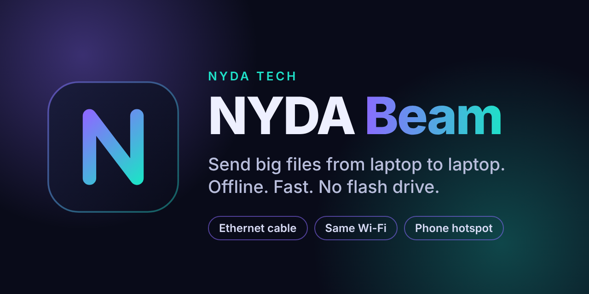
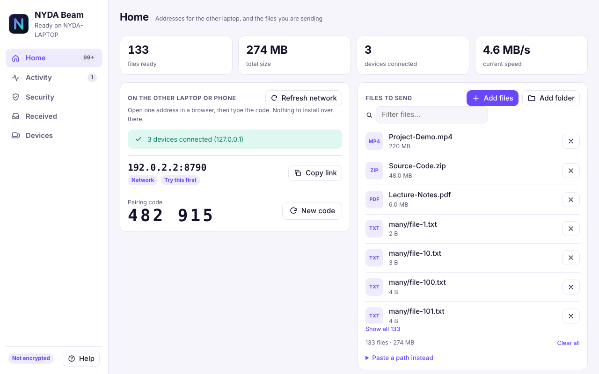
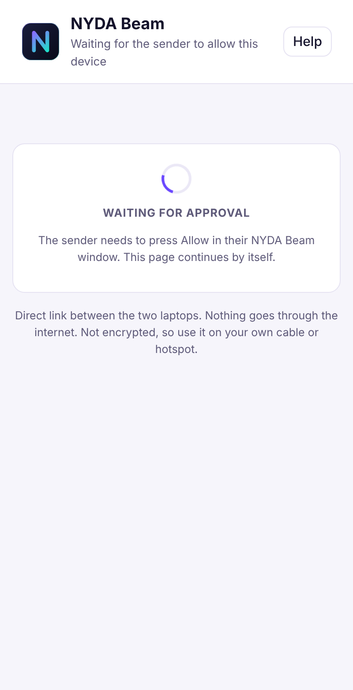
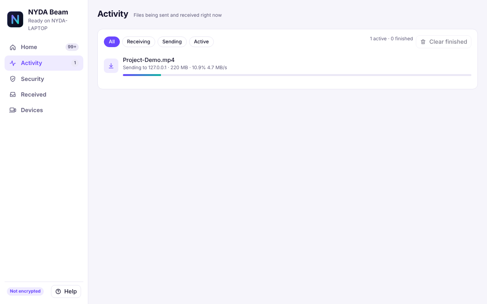
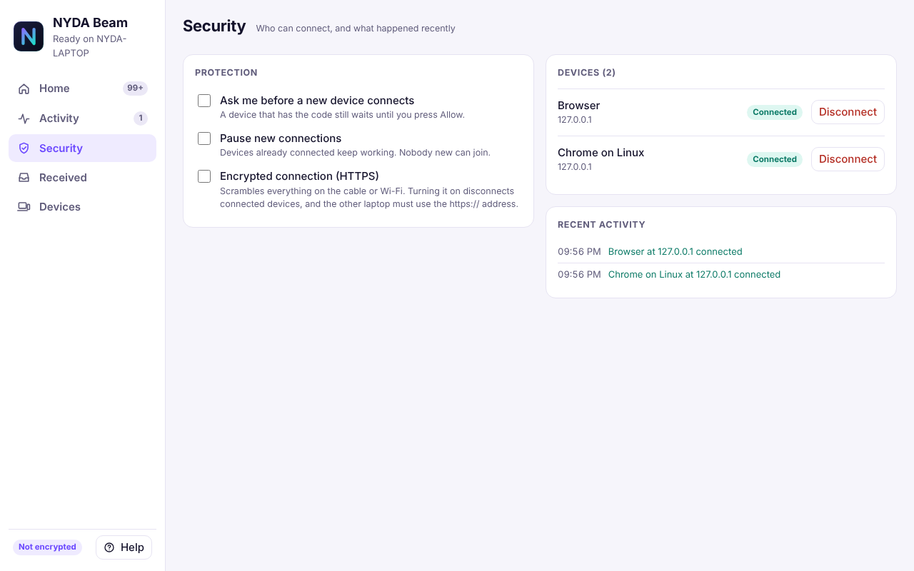
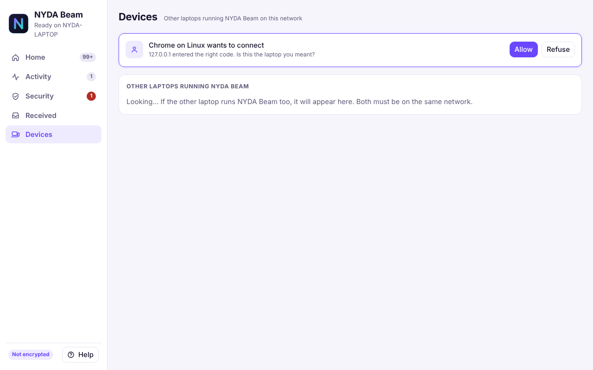
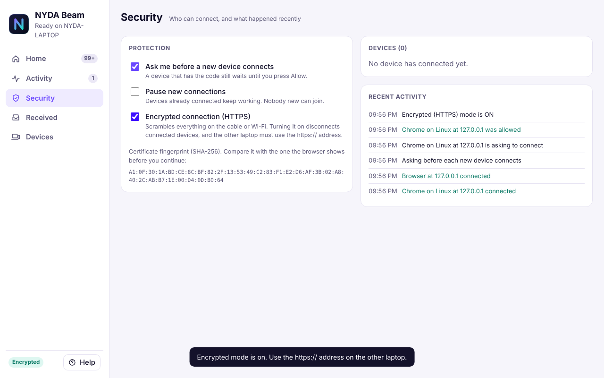
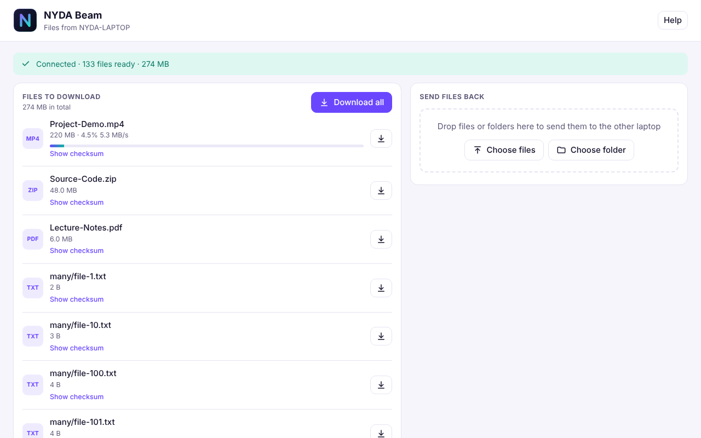
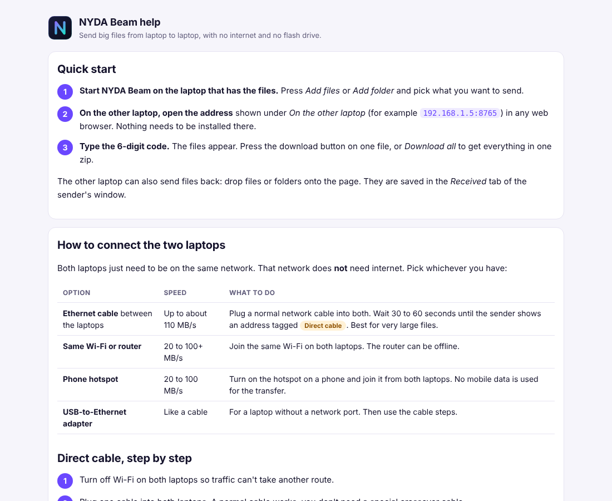
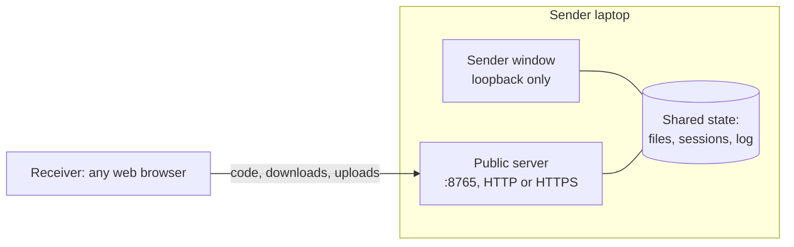

<p align="center">
  
</p>

<p align="center">
  
  
  
  
  
</p>

# NYDA Beam

**Send big files from one laptop to another with no internet and no flash drive.**

One laptop shares files. The other opens a link in any web browser, types a 6-digit code, and downloads. Nothing to install on the receiving side, no accounts, no cloud. Join the two laptops with an Ethernet cable, the same Wi-Fi, or a phone hotspot, and Beam moves your files at whatever speed that link allows.

Built by [Daniel Chifamba](https://github.com/danielChifamba) at **NYDA Tech**.

## Why it exists

A flash drive is slow, easy to forget, and fiddly for multi-gigabyte folders. Cloud services need internet and upload everything twice. Beam is the third option: a direct line between two machines in the same room, started in seconds.

## Features

**Fast and easy**
- Receiver needs **only a browser**. Open the address, type the code, done.
- Streams files in small pieces, so a 50 GB file uses almost no memory.
- **Resume**: an interrupted download carries on from where it stopped.
- **Download all** as one streamed zip, no temporary file, no size limit.
- **Folders** keep their structure. Existing files are never overwritten.
- **Two-way**: the receiver can drag and drop files and folders back.
- Live speed and progress on both laptops, plus a SHA-256 checksum button to verify files.
- **Auto-discovery**: if both laptops run Beam, each finds the other without typing an address.
- Works over **Ethernet cable, Wi-Fi or phone hotspot**. Addresses are labelled and ranked, so you know which one a phone can use.
- A **full-window app** with tabs (Home, Activity, Security, Received, Devices) that stays usable with hundreds of files and many devices.
- Desktop window, **or a full command line** (`beam movie.mp4`).

**Secure**
- **6-digit pairing code**, with lockouts and automatic code change under attack.
- **Allow prompt**: optionally make every new device wait for you to press Allow.
- **Pause new connections** and **Disconnect** any device, any time.
- **Encrypted mode (HTTPS)** with a certificate fingerprint you can check.
- The **control panel never touches the network**: it lives on a loopback-only server.
- Sessions are tied to the device's address, expire when idle, and use `HttpOnly`, `SameSite=Strict` cookies.
- A security log shows who connected, who was refused and who guessed wrong.

More detail in [Security](#security) and [SECURITY.md](SECURITY.md).

## Screenshots

<table>
  <tr>
    <td width="60%"></td>
    <td width="40%"></td>
  </tr>
  <tr>
    <td align="center"><sub>Home tab: ranked, labelled addresses and your files</sub></td>
    <td align="center"><sub>What a phone or other laptop sees</sub></td>
  </tr>
  <tr>
    <td></td>
    <td></td>
  </tr>
  <tr>
    <td align="center"><sub>Activity tab: live speed, filters, Clear finished</sub></td>
    <td align="center"><sub>Security tab: switches, devices, 40-entry log</sub></td>
  </tr>
  <tr>
    <td></td>
    <td></td>
  </tr>
  <tr>
    <td align="center"><sub>Approval banner shows on every tab</sub></td>
    <td align="center"><sub>Encrypted mode with certificate fingerprint</sub></td>
  </tr>
  <tr>
    <td></td>
    <td></td>
  </tr>
  <tr>
    <td align="center"><sub>Receiver page fills the window</sub></td>
    <td align="center"><sub>Built-in help</sub></td>
  </tr>
</table>


## Connecting two laptops with no internet

Both laptops only need to be on the same network. That network does not need internet.

| Option | Speed | How |
|---|---|---|
| **Ethernet cable** between the laptops | about 110 MB/s on gigabit | Plug in a normal cable and wait 30 to 60 seconds until Beam shows an address tagged *Direct cable*. Best for huge files. |
| **Same Wi-Fi or router** | 20 to 100+ MB/s | Join the same network. The router can be offline. |
| **Phone hotspot** | 20 to 100 MB/s | Both laptops join the phone's hotspot. No mobile data is used for the transfer. |
| **USB-to-Ethernet adapter** | like a cable | For a laptop with no network port. |

If a bare cable doesn't come up by itself, `beam cable` prints the manual steps. The full walkthrough, firewall tips and troubleshooting are in the **[User Guide](docs/USER_GUIDE.md)** and in the app's **Help** button.

> **First run on Windows:** the firewall asks whether to allow the app. Tick **Private networks**. Without that, the other laptop can't connect.

## Command line

```text
beam                         open the app
beam movie.mp4 "My Folder"   share these straight away
beam find                    list other laptops running NYDA Beam
beam guide                   quick guide in the terminal
beam cable                   manual steps for a direct cable link
```

| Option | What it does |
|---|---|
| `--secure` / `--no-secure` | Encrypted (HTTPS) connection on or off |
| `--approve` / `--no-approve` | Ask before each new device may connect |
| `--code 123456` | Choose your own 6-digit pairing code |
| `--name "Daniel's laptop"` | Name shown to the other laptop |
| `--port 9000` | First port to try (default 8765; the next free one is used if busy) |
| `--inbox D:\Received` | Where files sent back to you are saved (default `Downloads\NYDA Beam`) |
| `--no-upload` | Don't accept files from the other laptop |
| `--no-gui` | Terminal only, no window |
| `--no-discovery` | Don't announce this laptop on the network |

Run `beam --help` for everything.

## Security

Beam is meant for two machines you control, on a link you control. Within that, it defends in layers:

| Layer | What it does |
|---|---|
| Pairing code | Nothing is served without the 6-digit code. 5 wrong tries lock a device out (30 seconds, doubling up to 5 minutes). After 30 wrong guesses in total the code changes itself. |
| Allow prompt | Optional. A device with the right code still waits until you press **Allow**. |
| Pause / Disconnect | Stop new devices joining, or remove a connected one instantly. **New code** disconnects everyone. |
| Sessions | Tied to the device's address, so a copied cookie is useless elsewhere. They expire after 4 hours idle or 24 hours. Cookies are `HttpOnly` and `SameSite=Strict`. |
| Encrypted mode | HTTPS with a self-made certificate (TLS 1.2 or newer). The sender shows the fingerprint to compare with the browser's warning. |
| Separate control panel | The sender's window runs on its own server bound to `127.0.0.1`. The network-facing server has no control routes at all. It also checks the `Host` header and a per-run secret. |
| Safe uploads | Names from the other laptop are sanitised, so nothing can be written outside the receive folder. Partial uploads are discarded. |
| Hardened responses | `Content-Security-Policy`, `X-Frame-Options`, `nosniff`, no caching, and cross-site `POST`s are refused. |

**Plain mode is not encrypted.** That is fine on your own cable or your own phone hotspot. On any network you don't trust, turn on **Encrypted connection (HTTPS)** in the Security panel (or run `beam --secure`) and use the Allow prompt. Encrypted mode needs the `cryptography` package or OpenSSL on the sender's laptop.

Read the full model, including limitations, in [SECURITY.md](SECURITY.md).

## How it works



- A small server on the sender streams files with HTTP range support (that is what makes resume work) and uses the operating system's `sendfile` for speed on plain connections.
- The receiver page is plain HTML and JavaScript served by the sender. It needs no internet, no CDN and no install.
- A UDP beacon on port 48555 lets two Beam laptops find each other. It announces the laptop's name, a port, a file count and the total size. Never file names or the code.

## License

[MIT](LICENSE) © 2026 Daniel Chifamba, NYDA Tech